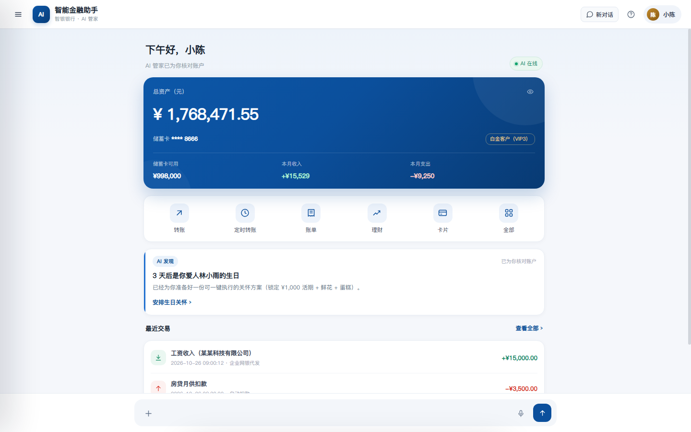
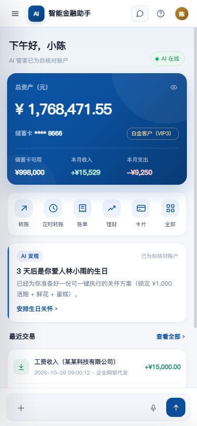
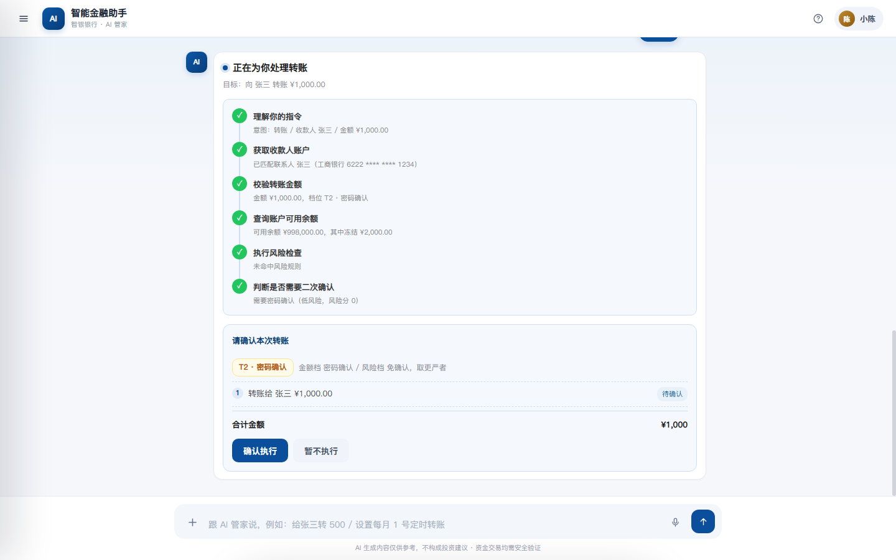
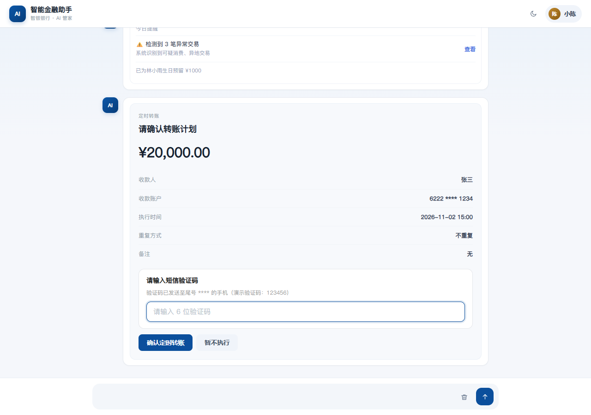
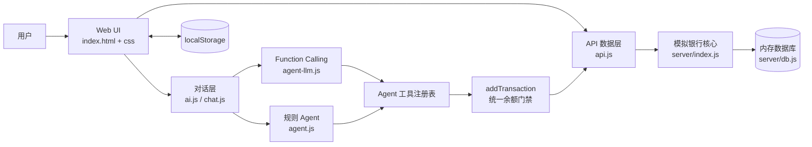

# 智能金融助手 · 项目说明

> 文档版本：v1.1（2026-10-25）  
> 项目类型：AI Banking Agent 演示原型  
> 运行形态：单端口 Web 应用（原生 HTML / CSS / JavaScript + 零依赖 Node.js 模拟银行核心）  
> 本地入口：`http://127.0.0.1:8787/`

---

## 0. 一句话概括

这是一个“手机银行 App + AI 管家”的演示项目：用户既可以通过银行服务面板一步步操作，也可以直接用自然语言对 AI 说“给张三转 1000”“设置每月 1 号定时转账”“我有 5 万闲钱怎么配置”。

项目的重点不是接真实银行接口，而是演示一套完整的 **AI 金融助手执行链路**：

```text
自然语言 / 表单 / 语音
        ↓
意图识别与槽位补全
        ↓
Agent 规划 + 风险识别 + 金额分级
        ↓
用户确认 / 二次验证
        ↓
统一工具执行
        ↓
余额、流水、持仓、订阅、额度等数据联动
        ↓
模拟银行核心 API 同步 + 本地持久化
```

---

## 1. 界面预览

| 桌面端首页 | 移动端首页 |
|---|---|
|  |  |

| 逐步引导式转账确认 | 定时转账验证 |
|---|---|
|  |  |

界面采用“稳重深蓝”的手机银行视觉：深蓝主色、白色卡片、红色支出、绿色收入、低饱和背景、统一线性图标。桌面端和 390px 移动端都做了适配。

---

## 2. 项目定位与能力

### 2.1 它是什么

- 一个面向个人客户的 **AI 金融助手 Demo**。
- 一个可离线演示的 **手机银行交互原型**。
- 一个包含 **Agent 工具调用、风险分级、确认卡、验证码、数据联动** 的完整前端示例。
- 一个带 **模拟银行核心后端** 的单端口应用，前端不需要打包工具。

### 2.2 它不是什么

- 不是可直接上线的真实银行系统。
- 不连接真实支付、清算、征信、短信、风控或核心银行系统。
- 所有余额、账单、持仓、额度、订阅、转账均为演示数据。
- 不构成投资建议。

### 2.3 已实现的主要能力

- 智能转账：姓名、手机号、银行卡号、AA、批量、语音、定时。
- 转账确认：金额分级 T1–T4、风险提示、确认卡、二次验证码。
- 定时转账：创建时验证码、到期自动执行、执行前可取消、可重复。
- 理财：风险测评、产品列表、申购、赎回、持仓、基金定投。
- 信用卡：额度分层查询、调额申请、挂失/解挂、账单分期计算。
- 订阅：订阅清单、月度均摊、取消订阅、添加订阅、首次扣费。
- 预算：日/周/月/年预算、预算水位、超支提示。
- 账单：分类统计、高 DPI 环形图、HTML 分类条、异常交易、财务报告。
- 用户信息：账户总览、基本信息、卡片贷款、交易记录、联系人。
- 安全：交易密码、短信验证码、指纹模拟、敏感信息遮罩。
- AI 增强：用户画像、消费决策、风险识别、跨场景规划、财务健康评分、金融知识库、场景推理。
- 主动服务：首页 AI 发现、定时任务执行提醒、主动风险提醒。

---

## 3. 快速开始

### 3.1 环境要求

- Node.js >= 18（推荐 20+）
- 现代浏览器（Chrome / Edge / Safari）
- 可选的公网访问：DeepSeek 与硅基流动语音识别接口
- 可选麦克风权限：语音输入

### 3.2 本地启动

```bash
npm start
```

等价于：

```bash
node server/index.js
```

默认地址：

```text
http://127.0.0.1:8787/
```

健康检查：

```bash
curl http://127.0.0.1:8787/api/health
```

### 3.3 演示验证码 / 密码

| 场景 | 演示值 |
|---|---|
| 交易密码 | `123456` |
| 短信验证码 | `123456` |
| 定时转账创建验证码 | `123456` |
| 指纹验证 | 点击后模拟 2.2 秒成功 |
| 敏感信息查看 | 走同一套安全验证弹窗 |

### 3.4 数据重置

- **只重置对话**：顶部栏 → 新对话。  
  会弹出应用内确认框；清空对话并回到首页，不会取消已创建的定时转账任务。
- **重置本地数据**：用户信息页 → 重置数据。  
  清除当前浏览器 `localStorage` 并刷新。
- **重置服务端数据**：先 `GET /api/session` 领取会话令牌，再带 `X-Bank-Session` 头调用 `POST /api/reset`。<br>会重建内存数据库，适合演示前恢复初始状态；无令牌/跨站请求会被拒绝。
- **彻底重置**：重启 `node server/index.js`。  
  服务端数据在内存中，重启即恢复初始数据。

### 3.5 密钥与 AI 能力配置

**浏览器不再持有真实 Key**。AI 能力（对话 / 意图分类 / Agent function calling / 语音识别）统一走服务端同源代理：

- 前端只调用 `/api/ai/chat` 和 `/api/ai/transcribe`；
- `server/index.js` 从环境变量或本机 `js/config.local.js` 读取 Key，在服务端转发到 DeepSeek / 硅基流动；
- 浏览器拿到的 `js/config.local.js` 只有 `window.__BANK_KEYS__ = {}` 和代理开关，永远不会包含真实 Key；
- 代理接口带同源校验和按 IP 限流（对话 20 次/分钟，语音 10 次/分钟）。

| 优先级 | 来源 | 说明 |
|---|---|---|
| 1 | 环境变量 | `DEEPSEEK_API_KEY` / `SILICONFLOW_API_KEY`（部署环境推荐） |
| 2 | `js/config.local.js` | 本机文件，已被 `.gitignore` 忽略；只由服务端读取，不发送给浏览器 |

首次使用：

```bash
cp js/config.local.example.js js/config.local.js   # 然后填入自己的 Key
```

无 Key 时的降级行为（演示主流程不受影响）：

| 能力 | 无 Key 表现 |
|---|---|
| AI 自由对话 | 回复「本地规则模式」提示，指令类操作照常执行 |
| 意图分类 | 自动降为本地正则/规则层 |
| Agent function calling | 静默走规则与场景层 |
| 语音识别 | 提示「语音识别未配置，请手动输入」，**不会自动提交任何随机指令** |
| 语音转账解析 | 跳过模型解析，文本交回对话链路 |

> ⚠️ 历史提交 `56f29d7`（tag `v1`）中仍留有旧的硬编码 Key。若要推送到公开仓库，请先作废/重置这两个 Key，或改写历史后再推送。

---

## 4. 目录结构

```text
deploy-v3/
├── README.md                  # 项目详细说明（本文档）
├── index.html                 # 单页应用外壳：顶部栏、抽屉、聊天区、用户信息页、输入区、服务面板
├── package.json               # 零依赖，仅 node server/index.js
├── Dockerfile                 # CloudBase CloudRun 容器部署
├── cloudbaserc.json           # CloudBase 环境与服务配置
├── .dockerignore
├── .workbuddy/
│   └── memory/2026-10-25.md   # 部署记录与踩坑说明
├── preview/                   # 界面预览截图（不参与应用运行）
├── css/
│   └── style.css              # 基础样式 + v9 银行 App 视觉覆盖层
├── js/
│   ├── icons.js               # 统一线性 SVG 图标
│   ├── config.js              # API Key、模型配置、mockData 初始数据、通用工具
│   ├── api.js                 # 前端 API 数据层：健康检查、快照注入、写操作同步
│   ├── storage.js             # localStorage 持久化、首页/抽屉/服务面板/用户信息页
│   ├── security.js            # 安全验证、用户信息渲染、addTransaction、quickAction、resetChat
│   ├── transfer.js            # 转账表单、批量、AA、定时转账、转账记录与撤销
│   ├── wealth.js              # 理财产品、风险测评、申购赎回、持仓、基金定投
│   ├── card.js                # 信用卡、调额、挂失、账单分期
│   ├── cardlimit.js           # 额度分层、调额申请工具、额度查询前置处理
│   ├── subscription.js        # 订阅列表、取消、添加、首次扣费
│   ├── budget.js              # 多周期预算设置与预算状态
│   ├── userinfo.js            # 用户信息入口
│   ├── analysis.js            # 账单分析、饼图/柱图、异常交易、财务报告
│   ├── flower.js              # 生日提醒、鲜花订购
│   ├── voice.js               # 录音、语音识别、语音转账、银行卡校验
│   ├── ai.js                  # 意图分类、功能询问、sendMessage 入口
│   ├── intent.js              # 旧版共享动作助手（高危确认、预算预填）
│   ├── agent.js               # Agent 核心：记忆、工具注册、余额门禁、风险分级、计划执行
│   ├── agent-llm.js           # Function Calling 层：工具 schema、模型循环、确认卡
│   ├── agentsvc.js            # 冻结资金与联系人服务前置处理
│   ├── context.js             # 对话上下文、指代消解、追问承接
│   ├── kb.js                  # 金融知识库 RAG
│   ├── scenario.js            # 资金安排场景推理
│   ├── profile.js             # 用户画像分析
│   ├── decision.js            # 消费决策分析
│   ├── riskdetect.js          # 高危金融行为识别
│   ├── planner.js             # 跨场景目标规划
│   ├── display.js             # 健康评分、负债体检、主动提醒卡
│   ├── visualization.js       # Canvas 趋势图、资产图、瀑布图
│   ├── insights.js            # 首页简报、AI 发现、主动推送、场景库
│   └── ui.js                  # 深色模式、Toast、服务面板渲染、使用手册、教程
└── server/
    ├── index.js               # 零依赖 HTTP 服务：静态资源 + 模拟银行核心 API
    └── db.js                  # 内存数据库：账户、账单、产品、订阅、持仓、额度
```

---

## 5. 总体架构

### 5.1 架构图



### 5.2 前端结构

前端没有使用 React/Vue，也没有打包器，采用传统多脚本加载：

1. `index.html` 负责页面骨架。
2. `css/style.css` 负责基础样式与银行 App 主题。
3. `js/*.js` 按依赖顺序加载，每个文件暴露全局函数。
4. `index.html` 末尾统一 `DOMContentLoaded` 初始化。

脚本加载顺序（简化）：

```text
icons → config → api → visualization → storage → security
→ transfer → wealth → card → subscription → budget → userinfo
→ analysis → flower → voice → ai → intent
→ agent → profile → decision → riskdetect → planner → display
→ cardlimit → agentsvc → context → kb → scenario → insights
→ agent-llm → chat → ui
```

因为所有业务函数都是全局声明，后加载的模块可以在运行时被先加载的 UI 调用；但如果要在初始化阶段直接调用，需要注意顺序。

### 5.3 后端结构

`server/index.js` 是一个零依赖 Node HTTP 服务：

- 同时提供静态文件与 API。
- 静态文件根目录是项目根目录。
- 默认端口 `8787`，容器环境通过 `PORT` 注入。
- 所有数据存放在 `server/db.js` 构建的内存对象 `DB` 中。
- 重启服务即重置数据，没有真正的数据库。

---

## 6. 数据模型与持久化

### 6.1 前端 `mockData`

`js/config.js` 定义了前端默认数据 `mockData`，包括：

- `contacts`：联系人（张三、李四、王五）。
- `bills`：当前月收入/支出分类。
- `products`：理财产品（稳健增利、货币基金、混合基金、定期、股票基金）。
- `card`：信用卡概览。
- `subscriptions`：订阅列表。
- `userProfile`：
  - 基本资料（姓名、身份证、手机号、地址、等级）。
  - 借记卡（余额、可用、冻结、今日收支）。
  - 信用卡（申请/审批/生效额度、已用、可用、账单、还款日）。
  - 贷款（剩余本金、月供、利率、期限）。
  - 最近交易、持仓、预算、转账记录、生日联系人。
  - 理财风险测评结果（`riskProfile`，包含等级、名称、描述、测评时间）。
- 人工复核记录（`manualReviews`，包含金额、业务类型、复核编号、提交时间、状态、绑定执行指令）。
- AA 收款请求（`aaRequests`，包含活动、总额、参与人员、每人应付、状态）。
- `riskProfile`：风险测评结果（运行时全局变量，会与 `userProfile.riskProfile` 同步）。

### 6.2 服务端内存数据库

`server/db.js` 的 `buildDB()` 构建：

- `userProfile`：与服务端一致的账户核心数据。
- `bills`：按当前月份动态生成。
- `monthlyHistory`：近三个月账单趋势。
- `products`、`subscriptions`、`contacts`、`card`、`funds`。
- `frozenItems`：冻结资金明细（类型、原因、金额、冻结时间、预计解冻日）。
- `insights`：服务端洞察快照。

服务端的 `addTxn()` 会：

- 往 `recentTxns` 头部插入流水（最多 50 条）。
- 更新今日收入/支出。
- 同步更新账单分类里的“其他收入/其他支出”。

### 6.3 localStorage

| Key | 用途 |
|---|---|
| `financeAssistantData_v1` | 用户资料、订阅、`cardFrozen`、定时转账等前端持久化 |
| `agent_memory_v2` | Agent 长期记忆（画像、家人、目标、笔记） |
| `agent_date_shift_v2` | 演示数据日期平移锚点 |
| `darkMode` | 深色模式开关 |
| `tutorialCompleted` | 教程完成标记 |
| `agent_proactive_pushed`（sessionStorage） | 主动推送是否已触发 |

### 6.4 API 快照与离线降级

`js/api.js` 的策略：

1. 页面启动时请求 `GET /api/health`。
2. 如果后端可达，请求 `GET /api/snapshot`。
3. 用快照覆盖前端 `mockData`。
4. 写操作先本地乐观更新，再 POST 到后端。
5. 后端不可达时自动降级为纯本地演示。

特别注意：

- **定时转账任务**保存在前端 `userProfile.scheduledTransfers`，服务端快照不包含该字段。`apiInjectSnapshot()` 会保留本地定时任务，避免刷新后任务消失。
- **理财风险测评结果**保存在 `userProfile.riskProfile`，快照注入时同样会保留。
- **人工复核记录**保存在 `userProfile.manualReviews`，快照注入时同样会保留。
- 快照注入后会补跑一次到期定时任务，避免初始化顺序导致漏执行。
- 服务端返回余额时，`apiPost()` 会用服务端余额回写本地。

---

## 7. 对话与 Agent 体系

### 7.1 消息处理优先级

`chat.js` 的 `enhancedSendMessage()` 是主对话流水线，顺序大致为：

1. 记录对话上下文。
2. 负债健康体检（只读分析）。
3. 信用卡额度/调额/纯数学计算前置处理。
4. 冻结资金明细、联系人管理前置处理。
5. 资金安排场景咨询。
6. **Function Calling 层**：`agentLLMHandle()`，模型决定调用哪些工具。
7. **规则/场景 Agent 层**：`agentHandle()`，确定性处理常见意图。
8. 指代消解（“刚才那笔”“不是张三是李四”）。
9. 多轮槽位补全（当前主要是转账）。
10. 转账类大模型意图分类（普通/批量/复杂）。
11. 本地复杂指令解析。
12. 单条指令执行。
13. 无法识别时调用普通 AI 回复。

这种分层的原因是：资金类操作不能完全依赖大模型，必须有确定性规则兜底；高风险行为必须能在进入执行前被拦截。

### 7.2 Agent 工具层

`agent.js` 通过 `registerAgentTool(name, { label, risk, run })` 注册工具，`agent-llm.js` 再把工具翻译成模型可调用的 Function Schema。

工具覆盖：

- 账户：余额、冻结明细、交易明细、画像、财务全景、健康评分、联系人。
- 账单：月度汇总、分类统计、异常检测、趋势。
- 订阅：列表、扣费扫描、取消。
- 转账：识别收款人、执行转账。
- 卡片：额度、额度分层、调额申请、挂失、解挂。
- 理财：产品、推荐、申购、赎回。
- 预算：状态、设置、专项预算。
- 借款：可借额度与利率。
- 生活：生日扫描、资金预留、鲜花、蛋糕、提醒、出差计划。
- 风险/决策/规划/知识：高危识别、购买决策、分期建议、目标规划、知识库检索、场景配置。

当前注册工具约 40+ 个。工具统一通过 `callAgentTool(name, args)` 执行。

### 7.3 Agent 记忆

`agent.js` 维护长期记忆 `AGENT_MEMORY`：

- 用户画像（姓名、城市、风险偏好、月均支出、确认阈值）。
- 家庭成员与生日。
- 理财目标。
- 近期备注。
- 工具执行结果摘要。
- 用户拒绝/风险拦截记录。

记忆保存在 `localStorage.agent_memory_v2`，在左侧抽屉“AI 记忆”中展示。

### 7.4 金额分级 T1–T4

转账按金额与可疑度取更严档：

| 档位 | 金额 | 执行要求 |
|---|---|---|
| T1 | ¥0.01–499.99 | 免确认，直接执行 |
| T2 | ¥500–4,999.99 | 确认卡 + 密码确认 |
| T3 | ¥5,000–49,999.99 | 确认 + 二次验证码 |
| T4 | ≥ ¥50,000 | 确认 + 二次验证码 + 提交人工复核（不立即扣款） |

最终档位取「金额档」与「风险档」中更严的一个：

- 低风险：按金额档执行。
- 中风险（风险分 30–59）：至少 T2。
- 高风险（风险分 ≥60）：至少 T3。
- 演示验证码统一为 `123456`。

风险评分的主要加分项：

- 收款人不在联系人中：+40。
- 该收款人历史无成功转账：+22。
- 金额达到历史平均转账的 3 倍以上：按倍数追加，最多 +28。
- 单笔 ≥ ¥20,000：+10；单笔 ≥ ¥50,000：+20。
- 交易时间在 00:00–06:00：+15。
- 分数上限 99；≥60 为高风险，30–59 为中风险，<30 为低风险。

因此，“新联系人 + 首次交易”本身就有 62 分，即使只转 100 元也会被抬到 T3 二次验证档。

> 说明：T1–T4 现在适用于所有“扣款类”入口：单笔转账、理财申购、基金定投计划创建、鲜花/蛋糕订购、订阅首次扣费、批量转账总额、语音转账。定时转账创建时统一要求验证码；T4 定时转账同样转人工复核、不创建自动扣款任务。理财赎回、AA 收款、预算设置等非扣款操作不叠加二次验证。

### 7.5 两种确认卡

项目里有两套确认 UI，但最终都调用同一批工具：

1. **Function Calling 确认卡**  
   `agentLLMRenderConfirm()` + `agentLLMApprove()`  
   用于模型自主规划路径，展示执行轨迹、风险标签、待确认操作、金额合计、验证码输入。

2. **规则/计划确认卡**  
   `agentRenderPlanConfirm()` + `agentApprovePlan()`  
   用于 `agentTransferFlow()` 等确定性路径，展示计划步骤、T2/T3/T4 档位、确认按钮。

两者都会在执行前再次校验：

- 用户二次风险闸门。
- T2 密码确认 / T3-T4 验证码。
- 可用余额。
- 工具层余额门禁。

### 7.6 逐步引导式与一键式一致性（本轮重点）

**问题根因：**

引导式对话补全“收款人 + 金额”后，走的是旧版 `executeSingleCommand()`，它会自己弹确认框并手动扣余额，绕过了 Agent 的余额门禁、风险分级、验证码和确认卡。一键式对话走 `agentTransferFlow()`，所以会出现“同样一笔转账，引导式直接成功、一键式要确认”的不一致。

**现在的处理：**

- 新增 `runUnifiedTransfer(payee, amount, rawText, channel)`，所有转账最终都走这里。
- 引导式补全信息后调用 `runUnifiedTransfer`。
- 旧规则层、LLM 分类兜底、复杂指令中的转账也调用 `runUnifiedTransfer`。
- `agentTransferFlow()` 返回 `planId`，复杂指令通过 `waitForPendingPlan()` 等待用户确认后再继续下一步。
- 所有前端本地余额变动统一走 `security.js` 的 `addTransaction()`，不再允许各模块手动改 `debitCard.balance` / `available`。

**结果：**

- 引导式“转账。→ 张三 → 1000”会出 T2 确认卡，确认前余额不变。
- 一键式“转账给张三1千元”同样出 T2 确认卡。
- 先转 1000 再查余额的复杂指令，会停在确认卡，确认后才执行查询。
- 确认后只扣一次款。

---

## 8. 核心业务流程

### 8.1 智能转账

入口：

- 对话直接说：“给张三转 1000”。
- 左侧菜单 / 首页快捷入口 / 全部服务面板 → 智能转账。
- 语音输入。
- 复杂指令里的转账步骤。

表单支持 2 个 Tab（智能转账）：

- 按姓名。
- 手机号。

银行卡转账已独立为「全部服务 → 更多 → 银行卡转账」的单模式表单。

定时转账、AA 收款各自独立成页。

#### 8.1.1 姓名转账：多轮槽位收集与意图理解

入口：服务向导 → 转账 → 姓名转账（`guideStartNameTransfer`）。

```
AI：请问收款人和转账金额是多少？
```

之后每一轮输入都按同一套规则解析，直到两个槽位齐全：

| 用户输入 | 抽取结果 | AI 回复 |
|---|---|---|
| `张三` | 收款人=张三，金额=空 | 麻烦告诉我转账金额 |
| `100`（先给金额） | 金额=100，收款人=空 | 请问要转给谁？ |
| `张三转 100` | 收款人=张三，金额=100 | 已记录…需要添加备注吗？【添加备注】【不用了】→ 确认向张三转账 100 元，请确认【确认转账】 |

**备注步骤**：槽位齐全后不直接出确认卡，而是先问「需要添加备注吗？」——点【添加备注】或输入「需要」则提示输入备注内容，输入后确认卡与交易记录都会带备注（`转账给张三（房租）`）；点【不用了】或输入「不用」则直接出确认卡。

**意图理解规则**（`guideTransferParse`）：

1. **金额**：正则 `(\d+(?:\.\d+)?)\s*(万|w|W)?` 抓第一个数字，带「万」按 ×10000 处理；抓到即从句子中剔除。
2. **收款人**：剔除金额与「给 / 向 / 转 / 转账 / 元 / 块 / 请 / 我 / 你 / 就 / 他」等口语成分后，剩余中文串
   - 先与通讯录姓名做包含匹配（命中即用通讯录标准名，如 `张三`）；
   - **只接受通讯录里的联系人**：非联系人的姓名会提示「不在通讯录里」，并列出可选联系人，收集状态保留；
   - `agentTransferFlow` 对姓名类渠道（`网银转账` / `智能转账` / `姓名转账`）同样校验，非联系人直接返回提示卡，不会进入风控与扣款。
3. **合并**：与本轮之前已收集的槽位合并（`guideTransferStep`），先给收款人还是先给金额都能补齐。
4. **收口**：两槽位齐全 → 先问「需要添加备注吗？」（可选）→ 再输出「确认向 X 转账 N 元，请确认」，调 `agentTransferFlow(payee, amount, '', '网银转账', { forceConfirm: true, okLabel: '确认转账', remark })`，**即使 T1 免确认档也先出确认卡**；点【确认转账】才执行。
5. **AI 兜底**：本地规则没抽全（两个槽位都空，或句子里出现中文数字如「一百」「一万五」「两百块」）时，不再干巴巴反问，而是把整句交给模型抽槽位（`guideTransferAIExtract`，输出 `{payee, amount, reply}`）：
   - 抽到就继续走确认流程，回复前带 `AI 理解` 小标签；
   - 抽不到就用模型给出的 `reply` 追问，并附「例如：张三 100」示例；
   - **无 Key / 请求失败**时降级为示例引导（仍可继续对话，不报错）；
   - 单个数字字（如「张三」里的「三」）不算中文数字，避免把姓名误判成金额。
6. **不拦截其它业务**：输入里出现「余额 / 账单 / 理财 / 订阅 / 信用卡 / 你好」等其它意图时，本条消息交回主链路作答，转账会话保持开启，下一句继续收槽位。
7. **会话内切换**：收集过程中直接说出服务名（`转账` / `账单分析` / `理财`…）或转账其它子功能（`手机号转账` / `定时转账` / `AA收款`），视为切换而非槽位输入——先清空本次收集，再打开对应二级菜单或表单，不会再回「没太听懂」。
8. **退出**：输入「取消 / 不转了 / 退出 / 返回」回到服务菜单。

确认卡之后仍复用原有风控链路：余额门禁 → 风险评分 → T1–T4 定档 → 密码/验证码/人工复核。

#### 8.1.2 手机号转账：同一套多轮收集

入口：服务向导 → 转账 → 手机号转账（`guideStartPhoneTransfer`），流程与姓名转账一致，只是把「收款人」换成「收款手机号」：

```
AI：请问收款手机号和转账金额是多少？
用户：13800138000            → 麻烦告诉我转账金额
用户：100                    → 已记录…需要添加备注吗？【添加备注】【不用了】
                            → 确认向 13800138000 转账 100 元，请确认【确认转账】
```

- 手机号用 **1 开头的 11 位数字**（`1\d{10}`）识别，且**先于金额**抽取，避免 11 位数字被当成转账金额；不限定运营商号段，演示号码 `12345678910` 也能识别。
- 先给金额也可以：「250」→ 请问收款手机号是多少？→ 输入手机号后继续。
- **陌生号码也支持转账**：手机号与金额齐了以后，
  - 命中通讯录 → 直接带出联系人姓名，进入备注步骤；
  - 不在通讯录 → 先要求「请输入收款人姓名完成验证」，姓名合法（2–20 字符、非纯数字）后进入备注步骤；
  - 确认卡显示「姓名（手机号）」，交易记录为 `转账给姓名（备注）`。
- 智能转账表单里的「手机号」页签同步调整，字段为：收款手机号、**收款人姓名**、转账金额、备注（选填）：
  - 手机号命中通讯录（按脱敏规则 `138****1234` 比对）→ 自动带出姓名并锁定，提示「已匹配联系人：张三（工商银行 6222 **** **** 1234）」；
  - 手机号不在通讯录 → 提示「请填写收款人姓名以完成验证」，姓名必填；不填直接提交会被拦截（「需要验证收款人姓名」）；
  - 手机号格式不是 1 开头的 11 位数字 → 拦截并提示格式错误。

姓名/手机号/银行卡号提交后会进入 `agentTransferFlow()`，统一做：

- 余额检查。
- 收款人识别。
- 风险评分。
- T1–T4 定档。
- 确认卡 / 验证码。
- `transfer.execute` 工具执行。
- 写入 `recentTxns` 与 `transferHistory`。
- 同步 `POST /api/transfer`。

### 8.2 定时转账

入口：服务向导 → 转账 → 定时转账（`guideStartTimedTransfer`）；「定时转账」列表里的 **+ 新建** 也走同一套对话流程。

**目标字段 3 个**：收款人、金额、执行时间；三样齐了再问「是否重复」，最后出确认卡。

```
AI：请问收款人、转账金额和执行时间是多少？
用户：张三，100，明天下午5点
AI：是否重复（每天/每周/每月/每年）？
用户：否
AI：确认定时向 张三 转账 100 元，执行时间：明天下午5点，不重复，请确认
    → 定时转账确认卡（收款账户 / 执行时间 / 重复方式 / 短信验证码 / 【确认定时转账】）
```

#### 8.2.1 缺失字段的追问文案（按缺失组合，不会从头再问）

| 已有字段 | 追问 |
|---|---|
| 无（初始） | 请问收款人、转账金额和执行时间是多少？ |
| 只有收款人 | 麻烦告诉转账金额和执行时间是多少 |
| 只有金额 | 麻烦告诉收款人和执行时间是多少 |
| 只有执行时间 | 麻烦告诉收款人和转账金额是多少 |
| 缺执行时间 | 麻烦告诉我执行时间是多少 |
| 缺金额 | 麻烦告诉我转账金额是多少 |
| 缺收款人 | 麻烦告诉我收款人是多少 |

对应 10 套对话：单字段起始 3 种 ×（剩余一次说完 / 分开说）= 6，双字段起始 3 种，三字段一次说清 1 种。

#### 8.2.2 重复方式

- 三字段齐了才问：`是否重复（每天/每周/每月/每年）？`
- 回答识别：`否 / 不 / 不用 / 单次` → 不重复；`每天 / 每周 / 每月 / 每年`（可带「重复」）→ 对应循环。
- 确认文案：`每日循环执行 / 每周循环执行 / 每月循环执行 / 每年循环执行 / 不重复`。
- 识别不了时只回一句「请回复：不重复 / 每天 / 每周 / 每月 / 每年」，不丢已收集字段。

#### 8.2.3 解析与校验

- **日期**：`今天 / 明天 / 后天 / 大后天`、`YYYY-MM-DD`、`M月D日`、`M-D`、`D号`（本月已过则顺延下月）。
- **时间**：`09:30`、`9点`、`9点半`、`下午3点`（→17:00）、`晚上8点`（→20:00）、`上午9点`；只说了时间段（如「明天下午」）会追问「下午几点执行」。
- **确认文案里的时间**用口语回显：`今天/明天/后天 HH:mm` → `明天下午5点` 这种写法。
- **收款人**必须是通讯录联系人（同姓名转账规则），非联系人直接提示，不进入槽位。
- **校验**：执行时间必须晚于当前时间（至少 1 分钟）；不合法时清空时间并要求重给，其它字段保留。
- 确认后进入验证码流程：输入 6 位验证码（演示 `123456`）→ 写入 `userProfile.scheduledTransfers`，状态 `待执行`。
- **创建时不扣款、不写交易流水**。

到期执行：

- 页面加载后会检查一次（约 300–600ms，取决于是否已注入服务端快照）。
- 之后每 30 秒检查一次。
- 到期任务通过 `addTransaction()` 扣款，写入转账记录，并同步后端。
- 不重复任务变为 `已完成`。
- 每天/每周/每月/每年任务计算下一次执行时间（跨年任务按年顺延，2 月 29 日会落到平年 2 月 28 日）。
- 余额不足时状态变为 `执行失败`，不扣款，并给出结果卡。
- 任务可在“定时转账”列表中取消。
- 浏览器关闭时不会真正执行；重新打开页面会补跑到期任务。这是前端演示实现的边界。

### 8.3 批量转账 / AA / 语音

- **批量转账**：选择多人，统一金额或分别设置金额，确认后逐笔调用 `transfer.execute`。
- **AA 收款（对话式）**：服务向导 → 转账 → AA收款（`guideStartAATransfer`）。规则：发起人＝当前登录用户「我」，本身计入分摊；单人应付 ＝ 垫付总额 ÷（名单人数 + 1）。

  ```
  AI：请告诉我你垫付的总金额和除你外需要收款的参与人
  用户：200，收张三、李四、王五
  AI：还有其他参与人吗？
  用户：没有
  AI：确认由你先行垫付 200 元，本次 AA 一共 4 人（包含你）分摊，向 张三、李四、王五 收款，每人应付 50 元，请确认
      【发起AA收款】
  ```

  | 场景 | 行为 |
  |---|---|
  | 先给金额（`200`） | 追问「麻烦告诉我除你外需要收款的参与人」 |
  | 先给名单（`张三，李四，王五`） | 先问「还有其他参与人吗？」→「没有」→ 追问「麻烦告诉我你垫付的总金额」 |
  | 一次给全（`200，收张三、李四、王五`） | 直接问「还有其他参与人吗？」→「没有」→ 确认 |
  | 名单逐个补充（`张三` → `李四` → `王五`） | 每次补充后都问一次「还有其他参与人吗？」 |
  | 重名联系人 | 「查询到 2 位【张三】，请选择…」＋选项 ①张三（138****1234）②张三（135****0000），选完继续问「还有其他参与人吗？」 |
  | 非通讯录姓名 | 提示不在通讯录并列出可选联系人，不中断已收集的名单 |

  - 名单去重按手机号判断；重名选择支持点按钮、回 `1/2`、回 `①/②` 或回手机号后四位。
  - 点击【发起AA收款】后只登记 `userProfile.aaRequests`（状态 `待收款`），**我不扣款、不写支出流水**。
  - 语音 AA 仍走原来的预填表单（`openAAForm`），不受对话流程影响。
- **语音转账**：浏览器录音 → 硅基流动 ASR → 解析转账要素 → 显示可编辑确认卡 → 执行。
  - 姓名/手机号/银行卡转账已补上余额校验；
  - 余额不足不会提示“成功”；
  - 转账后同步后端。

### 8.4 理财

功能：

- 产品列表与风险等级。
- 风险测评（5 题，计算风险等级；结果持久化，支持随时重新测评）。**有效期 1 年**：`riskProfileValid()` 按 `assessedAtTs` 判断，过期后产品列表与申购都会要求重新测评。
- 申购：调用 `wealth.buy` 工具，检查起购金额与可用余额，扣款、写持仓、写流水、同步后端。
- 赎回：调用 `wealth.redeem` 工具，减少持仓、回补余额、写流水、同步后端。
- 持仓管理（对话内简版）：概览压缩为「持仓总金额」+「累计收益（含总收益率）」两行，标题带产品只数；明细只展示持有金额 / 累计收益 / 收益率 / 买入日期，**不含赎回与追加申购按钮**，改为对话里选择操作（详见 8.4.2）。
- 基金定投：创建计划、按日/周/月执行、自动扣款；创建时按金额分级验证，执行时使用统一余额门禁。
- 定投执行使用统一的 `addTransaction()`，修复了原先重复扣款的问题。

#### 8.4.1 理财申购（对话式）

入口：服务向导 → 理财 → 产品申购（`guideStartWealthPurchase`）。

```
AI：您的风险测评结果：稳健型 R2。结合您当前资产情况，为您推荐适配产品：
    ① 稳健增利90天（R2，90天，参考近7日年化 3.85%）
    ② 安享三年定期（R1，3年，参考年利率 2.75%）
    您可以选择以上推荐产品，也可以自行指定理财产品，并告诉我申购金额
用户：稳健增利90天，50000
AI：确认申购【稳健增利90天】50000 元，默认从活期主账户（尾号8666）扣款，请确认
    [确认申购] [取消]
```

| 情况 | 行为 |
|---|---|
| 有有效风评，只输入产品 | 先播报等级 + 推荐两款适配产品 → 用户给产品 → 「麻烦告诉我您的申购金额」→ 确认 |
| 有有效风评，产品 + 金额一次说 | 直接出确认卡（产品名里的「90天」不会被当成金额） |
| 有有效风评，只输入金额 | 「麻烦告诉我您想申购的理财产品」并列出在售产品 → 用户给产品 → 确认 |
| 无风评 / 风评过期（>1 年） | 「需要先完成风险测评…是否现在开始测评？」→ 用户答「好的」→ 走 5 题测评 → 测完自动接着播报等级与推荐产品 |

- 产品名模糊匹配：`稳健增利` / `稳利90天` 这类不完整说法也能对上（最长公共子串 ≥ 3 字）。
- **查询所有产品**：推荐卡底部有【查询所有产品】按钮；也可以直接输入「查询所有产品 / 全部产品 / 更多产品 / 产品列表」，无论当前在哪个模块都会列出全部在售产品（带起购金额，以及「适配 / 超出您当前 R2 承受能力」标记）。
- 风险等级高于用户等级：**不再直接拦截**，先提醒「该产品波动可能超过您的承受范围，是否仍要申购？」+【仍然申购】【换个产品】；选「仍然申购」后确认卡会标注风险等级提示，继续走金额风控与申购流程；选「换个产品」则取消并给出适配产品。低于起购金额 / 可用余额不足 → 提示重给金额。
- 确认后调用 `executeBuyProduct()` → `wealth.buy`，沿用金额风控（≥¥500 需密码/验证码，≥¥50,000 提交人工复核）。
- 扣款账户尾号取自用户储蓄卡（当前演示数据为 `8666`，不是写死的 1234）。

#### 8.4.2 持仓管理：追加申购 / 赎回（对话式）

入口：点击【持仓管理】按钮或输入「持仓管理 / 我的持仓」（`guideStartHoldings`）——先展示持仓卡片概览，再问「需要赎回还是追加申购呢？」。

**场景 1：追加申购**

```
AI：请告诉我要追加申购的产品名称以及申购金额。
用户：稳健增利90天，5000            （也支持只给产品，或只给金额）
AI：确认对【稳健增利90天】追加申购 5000 元，默认从活期主账户（尾号8666）扣款，请确认
    【确认申购】【修改】【取消】
→ 追加申购提交成功。
```

- 只给产品 → 「麻烦告诉我本次追加申购的金额」；只给金额 → 「麻烦告诉我您要追加申购的产品名称」
- 风险等级高于承受能力 → 「该产品风险等级 R3，高于您 R2 稳健型的风险承受等级，是否追加申购？」+【仍然追加】【取消】，确认后继续
- 校验：起购金额、可用余额、金额风控（`verifyAmountRisk`，≥¥500 需密码/验证码），通过后调用 `wealth.buy`

**场景 2：赎回**

```
AI：您可以选择赎回全部持仓，或者指定产品并告知赎回金额（全额赎回可直接回复“全额”）。
用户：赎回全部
AI：确认一键发起全部可赎回产品的赎回申请；封闭期内产品暂不支持赎回，资金到期后返还活期主账户（尾号8666），是否继续？
    封闭期产品：稳健增利90天
    【确认一键赎回】【取消】
→ 一键赎回指令已提交，可赎回产品受理成功，封闭期产品无法赎回。
```

- 指定产品 → 「请问您赎回多少金额？全额赎回可直接回复“全额”」；只给金额 → 「麻烦告诉我需要赎回的产品名称」
- 确认卡：`确认赎回【产品】5000 元，资金将返回活期主账户（尾号8666），请确认` +【确认赎回】【修改】【取消】
- **确认卡支持直接打字**（所有对话确认卡通用）：输入 `确认 / 确定 / 确认申购 / 确认赎回 / 提交` 等同于点按钮执行；输入 `修改` 回到填写、`取消` 提示已取消；`返回 / 菜单` 回服务菜单
- **封闭期校验**（`guideHoldingClosed`：买入日 + 产品期限 > 今天）：`【稳健增利90天】当前处于封闭期，暂不支持赎回。`
- **金额校验**：不得大于持有金额，非负有效数字
- 一键赎回自动跳过封闭期产品，结果里列出「已受理 / 封闭期未赎回」
- **一键赎回的说法**：只要句子里同时有「卖/赎/取回/提现/清仓」和「全部/所有/一键/都」，就按一键赎回处理（全部卖出、全卖、清仓、都卖掉 均可），单说「全部」也认
- **AI 兜底**（guideHoldingAIIntent）：本地同义词都没命中时，交给模型判断动作（追加申购 / 指定赎回 / 全部赎回）并抽取产品与金额；无 Key 时静默回落到追问
### 8.5 信用卡

- 卡片概览：卡面、总额度、已用、可用、账单、还款日。
- 额度分层：
  - 申请额度 `appliedLimit`
  - 审批额度 `approvedLimit`
  - 生效额度 `effectiveLimit`
  - 兼容字段 `limit`
- 调额统一走“申请 → 复核审批 → 生效”的申请表单，不再直接改生效额度。
- 支持提额和降额；**最低可调额度严格等于已用额度**（前端表单、提交校验、复核生效、服务端 `POST /api/card/adjust` 与 `/api/card/limit/approve` 四处一致拦截），保证信用额度不低于已用部分、可用额度不为负。
- 调额申请会进入“复核审批”队列，通过后才更新生效额度与可用额度。
- 挂失/解挂：先确认，再调用 `card.freeze` / `card.unfreeze`，并同步 `cardFrozen` 与 `creditCard.isFrozen`。入口：全部服务 → 卡片 → 卡片挂失。
- 信用卡交易限制：单笔限额 / 日累计限额 / 夜间交易 / 境外交易，持久化到 `userProfile.txnLimit`；`cardTxnLimitCheck()` 已接入**账单分期提交**，按「单笔限额 → 日累计限额 → 场景开关」顺序校验，命中即拦截且不产生扣款；「查看限制规则」按钮可查看当前阈值、今日已用与判定顺序。
- 卡片申请（对话式）：卡种 / 期望额度（¥5,000–¥200,000 校验）/ 用途 → 生成「审核中」申请记录并持久化，**同时进入「更多 → 复核审批」队列**；审批通过后才会核发新卡（我的卡片 +1），拒绝则申请记录置为「已拒绝」。详见 8.5.1。
- 我的卡片：`showCardMyCards()` 展示已持有卡片（卡种、尾号、额度、状态、发卡时间），入口：全部服务 → 卡片 → 我的卡片，或复核通过后的「查看我的卡片」。
- 卡片页（`showCardLimit`）会按 `userProfile.creditCards` 逐张渲染卡片：审批通过后新卡直接出现在卡片页，标题追加「共 N 张 · 总授信 ¥XXX」，并可跳转「管理全部卡片」。
- 账单分期计算器：3/6/9/12/18/24 期费率与月供测算。

#### 8.5.1 申请信用卡（对话式）

入口：全部服务 → 卡片 → 卡片申请，或直接输入「申请信用卡」（`guideStartCardApply`）。

```
AI：请告诉我你想办理的信用卡类型、期望额度，以及主要使用用途。
    可选卡种：白金信用卡、标准金卡、旅行信用卡、青年卡
    可选用途：日常消费、出行差旅、教育培训、大额购物、其他
用户：我想申请一张白金信用卡，额度 50000 元，主要用于日常消费。
AI：已整理你的申请信息
    - 卡种：白金信用卡
    - 期望额度：50,000 元
    - 主要用途：日常消费
    【提交申请】【取消】
```

缺失字段按已填数量追问：

| 已有 | 追问 |
|---|---|
| 都没有 | 请告诉我你想办理的信用卡类型、期望额度，以及主要使用用途。 |
| 只有卡种 | 请问期望额度是多少？主要用途是什么？ |
| 只有额度 | 请选择信用卡类型以及使用用途。（输入以「申请」开头时回执改为「识别到期望额度 50,000 元，…」） |
| 只有用途 | 请告诉我信用卡类型和期望额度。 |
| 缺用途 | 请问这张卡的主要用途是什么？ |
| 缺额度 | 请问你的期望额度是多少元？ |
| 缺卡种 | 请选择信用卡类型。 |

- **无效卡种**（如「钻石卡」）：`可选卡种仅有：白金信用卡、标准金卡、旅行信用卡、青年卡，请从中选择。`，已收集字段不受影响。
- 用途关键词兜底：差旅/出差 → 出行差旅，消费 → 日常消费，教育/培训 → 教育培训，购物/大额 → 大额购物。
- 提交：写入 `userProfile.cardApplications`（`status: 审核中`），并通过 `submitCardApplyReview()` 生成一条复核审批记录（`actions: [{ tool: 'card.applyCard', args }]`）。回复「信用卡申请已提交，状态为审核中，已进入「复核审批」队列…」+【查看申请记录】【查看复核审批】【再申请一张】。
- **复核审批**：全部服务 → 更多 → 复核审批（`showManualReviews`）可以看到「信用卡申请 · 白金信用卡」，管理员审批通过后调用 `approveCardApplication()`：
  - 新建一条卡片记录写入 `userProfile.creditCards`（状态 `已发卡`，带卡号尾号），我的卡片数量 +1；
  - 对应申请记录状态改为 `已通过`；
  - 审批拒绝调用 `rejectCardApplication()`，申请记录置为 `已拒绝`，不核发新卡。
- **申请记录**只展示 `卡种・用途` / `状态・日期`，最新置顶（`guideCardApplyRecords`）。

#### 8.5.2 信用卡额度调整申请（对话式）

入口：全部服务 → 卡片 → 额度调整，或输入「申请调整信用卡额度」（`guideStartCardLimitAdjust`）。

```
AI：请告诉我想要调整到的目标额度，以及调整原因。
    可选原因：消费需求增加、收入提升、信用记录良好、主动降低额度、长期不用、风险控制、其他
    当前额度 ¥90,000，最低可调至 ¥23,650（已用额度）
用户：把信用卡额度调整到 50000 元，原因是收入提升。
AI：确认额度调整申请
    - 目标额度：50,000 元
    - 调整原因：收入提升
    - 调整方向：降额（当前 ¥90,000）
    【提交申请】【取消】
```

| 情况 | 行为 |
|---|---|
| 完整输入（额度 + 原因） | 直接出「确认额度调整申请」 |
| 只给目标额度 | 「请选择本次额度的调整原因。」→ 补齐原因 → 确认 |
| 只给调整原因 | 「请问希望将额度调整到多少元？」→ 补齐额度 → 确认 |
| 降额 | 同上流程，方向标为「降额」 |

- **原因识别**：7 个标准原因整串优先；也支持口语兜底（消费需求增加 / 收入提升 / 信用良好 / 主动降额 / 长期不用 / 风险控制 / 其他）。
- **校验**：目标额度不能低于已用额度（`cardLimitMinimum()`），与生效额度相同会提示换一个数值。
- 提交调用 `cardLimitSubmitReview()`，写入 `userProfile.creditCard.limitApply*` 并进入复核审批队列（动作 `card.applyLimit`，通过后由 `applyCardLimitAdjustment()` 生效）。
- 提交结果：「额度调整申请已提交，当前状态待复核…」+ 一条「待复核 / 信用卡额度调整・原因 / 待复核・日期」记录 +【查看调额记录】。
- **调额记录**（`showCardLimitRecords`）只展示 `记录标题` / `状态・日期`，最新置顶，并附带当前生效额度与可用额度。

#### 8.5.3 交易限制设置（对话式，严格顺序采集）

入口：全部服务 → 卡片 → 交易限制，或输入「交易限制」（`guideStartTxnLimit`）。

```
AI：请设置单笔限额与每日限额。
用户：单笔最多5000元，每天最多10000元。
AI：是否允许夜间交易（23:00-06:00）？
用户：禁止
AI：是否允许境外交易？
用户：禁止
AI：
- 单笔限额：5,000 元
- 日累计限额：10,000 元
- 夜间交易（23:00-06:00）：禁止
- 境外交易：禁止
【确认设置】【取消】
→ 交易限制已更新完成。
```

采集顺序固定：单笔限额 → 日累计限额 → 夜间交易 → 境外交易 → 汇总确认。

| 情况 | 行为 |
|---|---|
| 一次性给两项限额 | 直接问夜间交易，再问境外交易，然后汇总 |
| 先给裸数字（`500`） | 记为日累计限额，追问「请输入单笔限额」 |
| 一次给两个裸数字（`100，1000`） | 按出现顺序拆成单笔 100 / 日累计 1,000，直接问夜间交易 |
| 先给单笔（`单笔最多50元`） | 追问「请输入每日限额」 |
| 单笔 > 日累计（`单笔10000，每天5000`） | 「您设置的单笔限额大于日累计限额，请核对确认。是否允许夜间交易（23:00-06:00）？」——**只提示、不自动改数值**，继续采集后续选项 |
| 夜间/境外输入非「允许/禁止」（如「都行」） | 「该选项仅可回复【允许】或【禁止】，请重新选择。」 |

- **金额校验**：限额必须为大于或等于 0 的有效数字。
- **选项校验**：夜间交易、境外交易仅接受「允许 / 禁止」。
- **AI 兜底识别**（`guideLLMJson` / `guideTxnLimitAIFlag` / `guideTxnLimitAILimits`）：
  - 限额回答：本地正则先认阿拉伯数字与「万」；遇到中文数字或口语（`单笔五千，每天一万`、`五百吧`）时交给模型抽取 `{single, daily}`；
  - 允许/禁止回答：本地先认 `允许 / 禁止 / 可以 / 行 / 是 / 不允许 / 不行`；未命中时交给模型判断语义（`当然可以` → 允许，`算了` → 禁止）；
  - 模型也判断不出（如 `都行`）才回复「该选项仅可回复【允许】或【禁止】，请重新选择。」；
  - **无 Key / 请求失败**时自动降级：只走本地规则，不会长时间卡住或报错（解析期间显示 typing 气泡）。
- 确认后写入 `userProfile.txnLimit` 并 `saveUserData()`；取消不保存。
#### 8.5.4 卡片挂失（对话式，不区分临时/正式）

入口：全部服务 → 卡片 → 卡片挂失，或输入「卡片挂失」（`guideStartCardLost`）。

```
AI：请提供需要挂失的卡片尾号。
    你名下的卡片尾号：8888。
用户：尾号 8888。
AI：确认挂失尾号 8888 的白金信用卡。
    ⚠️ 挂失后卡片直接冻结、无法继续交易；如需补卡，新卡预计 3-5 个工作日寄出。
    点击确认后需要通过交易密码或短信验证码完成风险验证。
    【确认挂失】【取消】
→（弹出安全验证：交易密码 / 短信验证码 / 指纹）
→ 挂失办理成功，卡片状态已更新。
```

- **只按尾号核验**：尾号必须匹配 `cardServiceCards()` 中真实持有的卡片，匹配不到会提示「未找到尾号 XXXX 的卡片」并列出可挂失的尾号，**不猜测卡种**。
- 卡种取自卡片真实数据（演示主卡为白金信用卡，尾号取卡片页展示卡号末四位 `8888`）。
- **不区分临时/正式挂失**，统一按一次挂失处理。
- **二次确认 + 风险验证**：点【确认挂失】先弹 `showSecurityVerification()`（交易密码 / 短信验证码 / 指纹），验证通过才调 `guideCardLostApply()` 冻结卡片；取消验证会提示「未通过安全验证，已取消挂失」，卡片状态不变。
- 冻结写入 `cardFrozen`、`creditCard.isFrozen` 与该卡状态 `已挂失`。

### 8.6 订阅

订阅模块统一为一个入口「订阅管理」（生活订购 → 订阅管理，`js/guide.js` 的 `GUIDE_SUB`），第一句先问要做哪件事：

```
AI：您想要添加订阅、取消订阅，还是管理自动续费？
    【添加订阅】【取消订阅】【管理自动续费】
```

三个分支各自先展示数据、再提问：

- **添加订阅**（`guideStartSubAdd`）：先展示「可订阅服务」列表（某易云 VIP / 某讯 VIP / 某度网盘 VIP，含月/季/年价格），再问「请选择订阅服务与扣费周期」，然后问是否开启自动续费，出确认卡【确认添加】【取消】。
  - 三种输入都支持：一次性给全 / 只给服务（追问周期）/ 只给周期（追问服务）；周期也认「年卡」「按月」等说法
  - 提交前做重复检测（同名有效订阅直接提示），扣费走 `verifyAmountRisk` + `addTransaction`，成功提示「某度网盘 VIP 添加成功，扣费周期按季扣费，自动续费已开启。」
- **取消订阅**（`guideStartSubCancel`）：先展示有效订阅列表，再问「请选择你想要取消的订阅项目」→ 确认卡（服务 / 当前扣费周期 / 自动续费状态 / 操作：取消订阅）+【确认取消】【返回】；确认后从订阅列表移除并写入历史记录，「返回」只提示「未执行取消，订阅状态保持原样」。
  - 无有效订阅时提示「当前没有可取消的有效订阅」并提供【查看总订阅情况】
- **管理自动续费**（`guideStartSubAutoRenew`）：先展示有效订阅（含各自自动续费状态）与历史记录，再问「需要取消或开启哪一项的自动续费？例如「关闭某讯 VIP 的自动续费」」→【确认修改自动续费】卡（当前 / 修改后）→ 确认后改写 `autoRenew`。
  - 在统一入口直接说完整意图（「关闭某讯 VIP 的自动续费」）会跳过选择，直接进确认卡
- **区分两类操作**：关闭自动续费 = 不再扣费、权益用到本期结束；取消订阅 = 直接终止权益并进历史记录。
- **历史记录**：`userProfile.subscriptionHistory`，展示 `服务・周期・自动续费：开启/关闭` + `已取消・时间`。
- 全部数据来自模拟记录，界面标注「本系统为模拟演示，不等同第三方平台真实会员状态。」
- 旧的订阅列表视图 `showSubscribeList()` 保留（可在其他位置调用），入口已切到对话流程。

### 8.7 预算

- 日/周/月/年四个周期独立生效。
- 年度预算按整年 `YYYY-` 统计，不再只匹配 1 月。
- 预算状态：已用、预算、使用率；超过预算显示“已超支”和“超出 ¥X”，不再误报“即将超支”。
- 对话设置预算：先确认，再写入并同步 `POST /api/budget/set`。
- 预算设置表单：一次设置多个周期。

### 8.8 账单、分析与可视化

- 账单分析：按当前交易流水统计，避免静态账单与动态流水重复相加；顶部总收入/总支出两栏汇总，下方「支出构成 + 收入构成」双环形图（各带占比图例），底部一行 AI 建议（按收支与支出集中度本地生成，无 Key 也有输出），移动端自适应。
- Canvas 饼图/柱图。
- 异常交易：大额、凌晨、可疑渠道。
- **主菜单直接给出提示**：进入主菜单时自动展示「检测到 N 笔异常交易」卡片 +【查看异常交易】；点按钮或输入「查看异常交易 / 异常交易」再看明细卡（showAbnormalSummary / showAbnormalAlert）
- 财务报告：与账单分析统一版式——顶部「总收入 / 总支出 / 订阅月均」三栏汇总，中部「收入分配 + 资产构成」双环形图（资产图例直接给出金额），底部一行 AI 建议；不再出现净现金流大卡与文字式「资产状况 / 建议」清单。
- 财务全景可视化：近三月趋势、资产结构、瀑布图。
- 财务健康评分：储蓄能力、消费稳定性、负债压力、风险水平。

### 8.8.1 账单分析（消费统计 + 账单报告合并，以可视化为主）

- 入口：全部服务 → 账单 → 账单分析；说「分析账单 / 看看账单 / 消费统计 / 账单报告 / 财务总览」都会直接弹出
- 内容（自上而下）：
  - 收支汇总：总收入 / 总支出（两列，手机端不截断）
  - **支出构成环形图** + 图例（drawReportDonut）
  - **收支与结余**：支出/收入占比条、储蓄率条、结余数字
  - **近 7 日支出趋势**：平滑曲线（canvas 绘制，含渐变填充、数据点、数值与日期标签）；近 7 日无支出时自动退化为「最近 7 笔支出」
  - **资产概览**：总资产 / 理财持仓 / 冻结金额（两列）
  - 底部一行 AI 建议（illAnalysisAdvice）
- 手机端适配：@media (max-width: 600px) 下报表两列收成单列、数字不再省略
- 旧的 showBillAnalysis() / showFinanceReport() 仍保留可复用，showFinancialOverview() 作为别名保留

### 8.9 鲜花订购 / 生日鲜花

**鲜花订购（对话式，`guideStartFlowerOrder`）**：已并入「生日鲜花」——在生日鲜花页点【订购鲜花】，或直接说「鲜花订购 / 订花」。收花人只能是生日联系人，每个联系人生日行上的【订鲜花】按钮会带出该联系人与其推荐花束。

- 采集字段：收花人、手机号、收货地址、花束款式、配送日期、配送时段、贺卡留言（≤30 字，可空）、支付方式（默认储蓄卡）
- **收花人只能是联系人**：必须是生日联系人（userProfile.birthdayContacts，为空时回退通讯录），非联系人会提示「不在联系人里，鲜花只能为联系人下单」并列出可选收花人；预填联系人也同样校验
- 可选花束：简约玫瑰 ¥199 / 向日葵花束 ¥229 / 混搭小花束 ¥159 / 康乃馨礼盒 ¥259
- 配送时段：上午 09:00–12:00、下午 14:00–18:00、晚间 19:00–21:00
- 三种输入都支持：一次说全 / 先给收花人再补其余 / 无贺卡（确认卡显示「贺卡留言：无」）
- 确认卡：收花人 / 联系电话 / 收货地址 / 花束款式 / 配送时间 / 贺卡留言 / 支付方式 +【提交订单】【改用信用卡支付】【取消】
  - 确认阶段说「改成信用卡支付」会即时重出确认卡（支付方式切换）
- 提交成功：「鲜花订单提交成功，将在配送日按时派送，你可以在生活订购记录里查看订单状态。」
- **后台规则**：配送日期不能早于当日（否则要求重填）；提交前校验储蓄卡可用余额，不足时提示改用信用卡；贺卡超过 30 字自动截断
- **查看订单**（`guideStartFlowerList`）：待配送 / 已完成两组，待配送订单带【修改订单】【取消订单】
- **修改订单**（`guideFlowerModifyStart`）：配送前可改，确认卡展示「原款式 → 新款式 / 其余信息保持不变 / 支付方式」+【确认修改】【返回】
- **取消订单**（`guideFlowerCancelStart`）：确认卡展示收花人与配送时间；距离配送不足 24 小时时提示「取消会收取少量服务费 ¥20」，确认后订单置为已取消并按规则扣服务费
- 订单数据存于 `userProfile.flowerOrders`（首次进入自动放两条演示记录：待配送的简约玫瑰/李四、已完成的康乃馨礼盒/王五）
- **生日提醒联动**：生日鲜花页近期生日卡片底部给出「X 生日快要到啦，要不要订购鲜花？」+【去订购鲜花】直接进入鲜花订购

生日鲜花（`showBirthdayReminder`）：

- 家庭联系人生日提醒（15 天内）。
- 鲜花推荐、价格、配送。
- 下单前确认，使用 `addTransaction()` 扣款；余额不足会失败。
- 可添加/删除生日联系人。
- **通讯录与生日联系人双向同步**（syncContactsBirthdays()）：生日页新增的人会自动补进用户信息 → 联系人；生日页删除时只清掉该联系人的生日信息（联系人本身保留）。用户信息 → 联系人的「共 N 人」与生日鲜花页一致。

### 8.10 用户信息与安全

用户信息页有 5 个 Tab：

- 账户总览：总资产与首页使用同一口径（储蓄卡余额 + 理财持仓 + 定期/基金/房产），净资产 = 总资产 - 贷款剩余。
- 基本信息。
- 卡片贷款。
- 交易记录（类型/日期筛选）。
- 联系人（新增/删除）。

安全能力：

- 交易密码（`123456`）。
- 短信验证码（`123456`）。
- 指纹验证模拟。
- 敏感信息遮罩与验证后显示。
- 新对话 / 重置数据。
- 安全中心评分与验证方式开关。

### 8.11 画像、决策、规划、知识库

- **用户画像**：年龄、职业、地域、客户层级、消费频率、现金流、风险属性、客户标签、健康评分、生命周期、个性化推荐。
- **消费决策**：买不买、是否分期、推荐期数、手续费、风险提示。
- **风险识别**：信用资金投资、高杠杆、过度负债、全仓买入、资金压力、异常渠道。
- **跨场景规划**：一年存 10 万、旅游、买电脑等多目标拆解。
- **金融知识库**：通货膨胀、利率、存款、信用卡、基金、债券、风险等级、资产配置等。
- **场景推理**：按金额、期限、用途、风险偏好给出分层资金安排。

### 8.12 人工复核（T4 大额交易）

- 触发条件：单笔/总额 ≥ `¥50,000`（T4 档）。
- 流程：确认卡 → 二次验证码 → **提交人工复核**。
- **提交后不扣款**，余额保持不变。
- 复核记录保存在 `userProfile.manualReviews`，刷新后仍保留。
- 查看入口：全部服务 → 更多 → **复核审批**；在列表中点击 **管理员审批**。
- 管理员审批支持“通过 / 拒绝”：
  - 通过：执行申请绑定的业务指令（转账、理财申购、鲜花等），可用余额随之更新；
  - 拒绝：只更新状态，不扣款；
  - 没有绑定可执行指令的申请只更新状态，并提示用户重新发起。
- 覆盖入口：转账、理财申购、鲜花/蛋糕、订阅首次扣费、批量转账、语音转账、基金定投创建、定时转账创建、信用卡额度调整。
- 当前演示版是简化的管理员审批界面，不是真实后台审批系统；审批记录和状态保存在本地。

---

## 9. 后端 API

`server/index.js` 提供以下接口（无鉴权，演示用）：

| 方法 | 路径 | 作用 |
|---|---|---|
| GET | `/api/health` | 健康检查 |
| GET | `/api/snapshot` | 全量快照：用户、账单、产品、订阅、联系人、卡、额度、健康评分、洞察 |
| GET | `/api/balance` | 借记卡余额、可用、冻结 |
| GET | `/api/bills` | 账单、近三月历史、汇总 |
| GET | `/api/wealth` | 理财产品与持仓 |
| GET | `/api/health-score` | 财务健康评分与生命周期 |
| GET | `/api/insights` | 主动洞察 |
| GET | `/api/card/limit` | 信用卡额度分层 |
| GET | `/api/balance/frozen` | 冻结资金明细 |
| GET | `/api/contacts` | 联系人列表 |
| POST | `/api/transfer` | 转账扣款、写流水、写转账记录 |
| POST | `/api/wealth/buy` | 理财申购 |
| POST | `/api/wealth/redeem` | 理财赎回 |
| POST | `/api/budget/set` | 设置预算 |
| POST | `/api/fund/create` | 创建专项预算并冻结资金 |
| POST | `/api/subscription/cancel` | 取消订阅 |
| POST | `/api/card/adjust` | 调额申请（支持提额/降额，进入待复核） |
| POST | `/api/card/limit/approve` | 复核通过后生效额度（降额不得低于已用额度） |
| POST | `/api/contact/add` | 新增联系人（卡号去重、格式校验） |
| POST | `/api/reset` | 重置内存数据库 |

其他请求会尝试作为静态文件返回。静态文件带目录穿越防护，API 响应带 `Cache-Control: no-store`，并允许跨域 `*`。

---

## 10. UI 设计

### 10.1 视觉方向

- 主色：稳重深蓝 `#0B4F9C`。
- 深色：`#083D79`。
- 背景：`#F4F6FA`。
- 卡片：白色、圆角 12–20px、轻阴影。
- 支出：红色；收入：绿色。
- 提示/风险：琥珀色、红色。
- 字体：系统字体栈，数字使用等宽数字。
- 图标：`js/icons.js` 统一线性 SVG，品牌与 AI 头像使用 “AI” 字标。

### 10.1.1 卡片统一层（v10）

`css/style.css` 末尾的「v10 卡片统一层」把此前各模块自成一色的卡片收敛为一套：

| 层级 | 底色 | 描边 | 圆角 | 覆盖对象 |
|---|---|---|---|---|
| 对话内模块卡片 | `#F7F9FC` | `1px #EAF0F7` | `12px` | 数据卡、**结果卡**、确认卡、报告卡（summary/panel/hero/metric）、订阅与理财产品项、持仓卡、空态卡 |
| 卡片内说明条 | `#FFFFFF` | `1px #EAF0F7` | `10px` | `bank-confirm-note`、`bank-inline-note`、`bank-dialog-note`、`bank-confirm-warn` |
| 页面级卡片 | `#FFFFFF` | `1px #EAF0F7` | `16px` | 首页快捷区、AI 发现、最近交易、定时任务项（页面底色已是浅灰，白卡才有层级） |

- 语义色卡片（成功绿 / 警示黄 / 风险红 / 评分渐变）保留原底色，只跟随统一圆角。
- 对应 CSS 变量：`--bank-card-bg`、`--bank-card-line`、`--bank-card-radius`、`--bank-note-*`、`--bank-page-card-radius`。
- 深色模式在同一区块内切换为 `#172335` 卡片 / `#111A28` 说明条。


### 10.2 页面结构

- **顶部栏**：菜单、AI 品牌、新对话、帮助、用户头像。
- **左侧抽屉**：用户卡片、AI 对话、银行服务、AI 记忆、使用手册/深色模式。
- **聊天区**：AI 首页（资产卡、快捷入口、AI 发现、最近交易）、对话消息、确认卡、结果卡。
- **输入区**：+ 全部服务、输入框、麦克风、发送。
- **全部服务面板**：5 组平铺服务 + 一行「更多」文字入口。

  | 分组 | 入口 | 落地页 |
  |---|---|---|
  | 转账 | 姓名转账 / 手机号转账 / 定时转账 / AA收款 | 对话式姓名转账 / 手机号转账 / 定时转账（+重复方式）/ AA 收款 |
  | 账单 | 账单分析 / 异常交易 | `showBillOverview`（可视化账单分析）/ `showAbnormalAlert` |
  | 卡片 | 卡片申请 / 额度调整 / 交易限制 / 卡片挂失 | `showCardApplyForm` / `cardLimitDetailCard` / `showTxnLimitSettings`（含「查看限制规则」）/ `showCardFreezePanel` |
  | 理财 | 产品申购 / 风险评估 / 持仓管理 | `guideStartWealthPurchase` / `startRiskAssessment` / `guideStartHoldings` |
  | 生活 | 订阅管理 / 生日鲜花 | `guideStartSubManage`（统一入口）/ `guideStartBirthdayFlower`（生日鲜花 + 鲜花订购） |
  | 更多 | 银行卡转账 / 转账记录 / 批量转账 / 预算管理 / 账单分期 / 复核审批 / 安全中心 | 银行卡转账为单模式表单；其余为原功能文字入口 |

  转账表单按入口收敛：**智能转账** 只含「按姓名 / 手机号 / 银行卡号」三种收款人识别方式；**定时转账** 与 **AA 收款** 各自独立成页（`showTransferForm('timed' | 'aa')`），不再以页签形式塞进同一张表单。

- **用户信息页**：独立页面，带返回按钮；采用简洁的银行式标签页、账户卡片和资料条目，不使用表情符号。
- **深色模式**：整站覆盖，持久化。
- **移动端**：390px 宽度适配，服务面板改为底部抽屉。

### 10.3 首页

对话起始现在是 **AI 服务向导**（`js/guide.js`），不再是财务驾驶舱：

```
你好，我是 AI Bank 助手
我可以为你提供这些服务：
🔹 转账 / 🔹 账单分析 / 🔹 卡片管理 / 🔹 理财 / 🔹 生活订购

你可以直接点击按钮，或者输入对应的功能名称。
[转账] [账单分析] [卡片管理] [理财] [生活订购]
```

- **一级菜单**：五个服务按钮。`账户概览`入口（打开原财务驾驶舱）**暂时屏蔽**，由 `js/guide.js` 顶部的 `GUIDE_SHOW_OVERVIEW = false` 控制，需要恢复时改成 `true` 即可（`guideOpenOverview()` 函数保留）。
- **二级菜单**：点「转账」→「您好，请问你需要姓名转账、手机号转账、定时转账，还是AA收款？」＋四个按钮；其余服务同理（账单分析 → 账单分析/异常交易；卡片管理 → 卡片申请/额度调整/交易限制/卡片挂失；理财 → 产品/风险评估/持仓；生活订购 → 订阅管理/生日鲜花）。
- **模块内上下文**：选定子项后 `currentModule` 记录当前模块，后续直接输入子功能名即可再次进入（如「定时转账」）；输入「返回 / 菜单」回到一级菜单；「新对话」重置上下文并重新显示起始菜单。
- **意图识别（先精确、再模糊、最后 AI 兜底）**：用户不一定照着按钮说话，`guideHandleText` 按四步识别：
  1. **精确匹配**：整词等于服务名/别名/子功能名（`转账`、`账单分析`、`产品申购`）。
  2. **模糊匹配**（`guideResolveIntent`）：先去掉「我要/我想/帮我/看一下/查一查/的功能/一下/个」等口语成分再匹配关键词；
     - 子功能关键词优先（如「我要看消费统计」→ 账单分析 → 消费统计；「帮我查下信用卡额度」→ 卡片管理 → 额度调整）；
     - 服务关键词兜底（转账 / 账单 / 卡片 / 理财 / 生活，见 `GUIDE_SERVICE_KEYWORDS`）。
  3. **AI 兜底**（`guideAIIntent`）：只在「明显是想打开某功能」的短句上触发（带数字或含「转给/转账」的业务指令不拦截，避免劫持 `给张三转100`），让模型在固定清单里选服务/子功能。
  4. **都认不出**：给一句提示并重新展示一级菜单按钮，而不是静默交给 Agent 链路。
- 模块内同样生效：在「账单分析」下输入「我要看报告」直接进账单报告，在「理财」下输入「看看风险评估」直接进测评。

#### 10.3.1 流程锁：一次业务没走完，不许切功能 / 重开一单

`guideActiveFlowLabel()` 判断当前是否有未完成的对话流程（转账 / 定时转账 / AA / 理财申购 / 信用卡申请 / 额度调整 / 交易限制 / 卡片挂失 / 持仓管理 / 订阅管理 / 鲜花订购），只要有：

- **不允许切服务**：说「理财」「账单」等别的服务名 → 提示「当前正在「X」流程中，请先完成这次操作」
- **不允许换子功能**：说「定时转账」等其它子功能 → 同样锁住（以前会直接切走）
- **不允许重开一单**：在「需要备注吗」这一步输入「张三转100」这类新指令，不再被当成备注吞掉，而是提示「请回复「添加备注」或「不用了」继续」
- **按钮也锁**：`quickAction()` 在流程中点击其它功能按钮会被拦下；`guideOpenService()` / `guidePickSub()` 内部同样有守卫
- **不放行闲聊/查询**：流程中问「查一下余额」也不再交给主链路，避免一次转账没完成就跳走
- **唯一出口**：回复「取消 / 返回 / 菜单」正常退出（各流程自己的取消文案保留）
- 兜底：`guideLockedRun()` 包住所有会话步骤，步骤返回 `false`（没接住）时也只会提示先完成，绝不落到 Agent 重新开单

#### 10.3.2 对话槽位的 AI 兜底（用户没有固定回答时统一交给模型）

原则：**本地规则先跑，认不出再问模型**；模型也不可用（无 Key / 失败）时回落到本地追问，不阻塞、不报错。
所有兜底都走同一个入口 `guideLLMJson()`，并复用 `guideAISlots()`（解析期间显示 typing 气泡，结束自动移除）。

| 场景 | 本地规则 | AI 兜底函数 | 说明 |
|---|---|---|---|
| 姓名 / 手机号转账 | 收款人、金额、手机号正则 | `guideTransferAIFallback` | 中文数字、口语整句抽槽位 |
| 定时转账 | 今天/明天/后天、`M月D日`、`H点`、每天/每周/… | `guideTimedAIExtract` | 「下周三」「月底下午三点」「一直」都能换算成具体日期时间与重复方式；时间说法被误当收款人时会撤销误判 |
| AA 收款 | 阿拉伯数字金额、通讯录姓名、没有/就这些 | `guideAAAIExtract` / `guideAAAIHasMore` | 「就我们几个搓一顿，一共三百」→ 300 + 张三/李四；本地解析出的名字不在通讯录时改由模型判断 |
| 信用卡申请 | 卡种全称、用途关键词 | `guideCardApplyAIType` | 「金卡」「主要出差用」→ 标准金卡 / 出行差旅 |
| 额度调整 | 7 个原因整串 + 口语兜底 | `guideCardLimitAIReason` | 「最近开销变大了，想提到六万」→ 消费需求增加 + 60000 |
| 交易限制 | 允许/禁止、数字与「万」 | `guideTxnLimitAIFlag` / `guideTxnLimitAILimits` | 「当然可以」→ 允许；「五千」→ 5000 |
| 理财申购 | 产品名最长公共子串、金额 | `guideWealthAIProduct` | 「那个稳的来五千」→ 稳健增利90天 + 5000 |
| 持仓管理 | 产品名匹配、全部卖出同义词 | `guideHoldingAIIntent` | 「全都抛了吧」→ 全部赎回 |
| 菜单意图 | 精确/关键词 | `guideAIIntent` | 「我要看消费统计」→ 直接进子功能 |

财务驾驶舱（原起始页，现由 `guideOpenOverview()` 按需打开）：

- 问候语 + AI 在线状态。
- 总资产卡（可隐藏金额）。
- 储蓄卡可用、本月收入、本月支出。
- 6 个快捷入口：转账、定时转账、账单、理财、卡片、全部。
- AI 发现卡（一条最重要的洞察）。
- 最近交易。
- 一句自然语言引导。

---

## 11. 安全与风控设计

### 11.1 统一余额门禁

前端所有本地余额变动集中在 `security.js` 的 `addTransaction()`：

- 检查可用余额。
- 拒绝把借记卡扣成负数。
- 更新余额、可用余额、今日收支。
- 写入最近交易。
- 保存本地数据。

其他模块不再直接修改 `debitCard.balance` / `available`。这是本轮一致性改造的核心。

### 11.2 风险分级

- 金额档 T1–T4 统一适用于扣款类操作：转账、理财申购、鲜花/蛋糕、订阅首次扣费、批量转账总额、语音转账。
- 可疑度可以抬档（转账场景）。
- 高风险行为在执行前识别并拒绝或给出替代方案。
- 余额不足时给出“降低金额 / 分批 / 信用卡 / 贷款”等方案。
- 非转账扣款入口使用 `verifyAmountRisk()`：金额达到 T2/T3/T4 时复用安全验证弹窗；T1 直接执行。

### 11.3 确认与验证

- 确认卡展示：收款人、金额、风险标签、档位、合计金额。
- T2 需要密码确认，T3/T4 需要验证码。
- T4 验证通过后不执行扣款，而是生成“待人工复核”记录；复核通过前余额不变。
- 确认后执行前再次校验余额与风险。
- 表单/语音/批量/定时/订阅取消/挂失等都有各自确认步骤。

### 11.4 演示边界

- 验证码、密码、指纹均为演示值。
- 没有真实短信、设备指纹、风控引擎。
- 没有登录、会话、权限、审计。
- 服务端 CORS 为 `*`，无鉴权。
- 不应把真实资金、真实身份证、真实银行卡放入此 Demo。

---

## 12. 测试与验收

本轮改动用无头 Chrome 做了交互验收，并用 `node --check` 检查所有 JS 语法。

已验证：

- 引导式转账：`转账。→ 张三 → 1000` 出 T2 确认卡，确认前余额不变；确认后只扣 `¥1,000`。
- 一键式转账：`转账给张三1千元` 同样出确认卡；确认后只扣一次。
- 复杂指令：`先转1000给张三，再查余额` 会等待转账确认，确认后才继续查询。
- 理财申购：表单路径扣 `¥1,000`，只扣一次；持仓同步增加。
- 理财申购 `¥2,000`：触发 T2 密码确认；`¥5,000` 触发 T3 安全验证；取消验证不扣款。
- 鲜花订购 `¥5,000`：触发 T3 安全验证。
- T4 `¥50,000`：验证后提交人工复核，余额不变；「全部服务 → 更多 → 复核审批」中可见记录。
- 信用卡额度：支持 `¥90,000 → ¥50,000` 降额和 `¥50,000 → ¥80,000` 提额；申请进入复核审批，通过后生效额度与可用额度同步更新；低于已用额度会被拒绝。
- 管理员审批：通过后执行原申请，储蓄卡可用余额从 ¥998,000 变为 ¥948,000；拒绝后余额不变。
- AA：默认勾选 3 位联系人和我，总额 ¥400，4 人分摊，每人应付 ¥100；提交不新增支出流水。
- 预算：年度已用覆盖整年，超过预算显示“已超支 / 超出 ¥X”。
- 首页与用户信息页的“总资产”使用同一口径，数值一致。
- 理财赎回：赎回 `¥50`，可用余额增加 `¥50`，持仓减少。
- 风险测评：完成后可点击“重新测评”，新结果覆盖旧结果并持久化，刷新后仍保留。
- 新对话：顶部栏「新对话」使用应用内确认弹层（不依赖原生 confirm），移动端点击“取消/开始新对话”均正常。
- 订阅添加：首次扣费 `¥25`，只扣一次。
- 订阅取消：确认后从列表移除。
- 信用卡挂失/解挂：`cardFrozen` 与 `creditCard.isFrozen` 状态一致。
- 批量转账：2 人 × `¥10`，共扣 `¥20`，生成 2 条转账记录。
- 鲜花订购：`¥168` 只扣一次；余额不足时失败且不扣款。
- 定时转账：创建时验证码、创建不扣款、到期执行、可取消、刷新后保留。
- 控制台无异常。

> 这些是演示验收，不是正式自动化测试套件；没有单元测试框架、E2E 测试框架或 CI。

---

## 13. 部署

### 13.1 本地

```bash
npm start
```

默认 `http://127.0.0.1:8787/`。

### 13.2 Docker

`Dockerfile`：

- 基础镜像：`node:20-alpine`。
- 复制整个项目到 `/app`。
- `ENV PORT=8080`。
- `EXPOSE 8080`。
- `CMD ["node", "/app/server/index.js"]`。

构建与运行：

```bash
docker build -t ai-banking-agent .
docker run -p 8080:8080 \
  -e DEEPSEEK_API_KEY=sk-xxx \
  -e SILICONFLOW_API_KEY=sk-xxx \
  ai-banking-agent
```

镜像内不含任何 Key：容器启动后 `GET /js/config.local.js` 会由环境变量即时生成配置。

### 13.3 腾讯云 CloudBase CloudRun

项目内已有 `cloudbaserc.json` 与部署记录：

- 环境：`base-d4g6gegsv70ec2031`（alias `base`，体验版 Trial，ap-shanghai）。
- 服务：`ai-banking-agent`。
- 公网访问（历史部署记录）：

```text
https://ai-banking-agent-335169-11-1386930579.sh.run.tcloudbase.com/
```

部署要点（来自 `.workbuddy/memory/2026-10-25.md`）：

- 首次部署使用相对路径 `CMD` 时容器内找不到 `server/index.js`。
- 已改为 `COPY . /app` + 绝对路径 `CMD ["node","/app/server/index.js"]`。
- 容器内端口为 `8080`。
- 服务 `MinNum=1` 常驻，响应快但按实例计费；可下调为 0 省费，代价是冷启动。
- 代码更新后重新走 CloudBase 源码构建部署即可。
- 密钥通过控制台「环境变量」配置 `DEEPSEEK_API_KEY` / `SILICONFLOW_API_KEY`，不要写进仓库。

### 13.4 生产化建议

- ✅ 已删除前端硬编码 API Key：Key 外置到 `js/config.local.js`（git 忽略）或环境变量注入；生产环境建议进一步改为服务端代理，前端完全不接触 Key。
- 增加登录、会话、权限、审计与限流。
- 使用真实数据库替代内存数据库。
- 使用服务端定时任务替代前端定时器。
- 增加 HTTPS 强制、CSP、CORS 白名单、密钥轮换。
- 为资金操作增加幂等键、事务、对账与回滚。
- 把验证码/密码/指纹替换为真实认证服务。

---

## 14. 已知边界与后续建议

1. **内存数据库**：重启服务即重置，不适合生产。
2. **API Key 硬编码**：`config.js` 中有 DeepSeek 与硅基流动语音识别 Key，生产必须迁移到服务端环境变量，且应轮换已暴露的 Key。
3. **无鉴权**：所有 API 公开，CORS 为 `*`，没有多用户隔离。
4. **定时转账是前端实现**：页面关闭时不会执行，重新打开会补跑；真实银行必须放到服务端调度。
5. **局部本地数据**：以下字段前端 localStorage 持有、后端核心不持有，`apiInjectSnapshot()` 会显式保留：`scheduledTransfers`、`riskProfile`、`manualReviews`、`aaRequests`、`creditCards`、`cardApplications`、`txnLimit`，以及主卡上的 `limitApply*` / `effectiveLimit` 等调额状态；其余字段仍会被服务端快照覆盖。
6. **AI/ASR 依赖外部服务**：网络或 Key 不可用时，Function Calling 会降级到规则层；语音识别不可用会影响语音转账。
7. **演示性风控**：T1–T4、风险评分、验证码、指纹均为演示逻辑，不是真实银行风控。
8. **信用卡额度**：调额走申请表单，审批与生效为模拟；降额等复杂场景未做完整业务闭环。
9. **数据一致性**：前端本地乐观更新 + 服务端快照，极端并发/多标签页下可能出现覆盖；真实系统需要事务与版本号。
10. **可访问性与兼容性**：主要面向现代浏览器；未做完整无障碍与旧浏览器兼容测试。

后续可以优先做：

- 服务端定时任务与任务持久化。
- 统一写操作 API 与幂等键。
- 前端密钥迁移与服务端 AI 代理。
- 登录/多用户/权限。
- 正式测试体系（单元 + E2E + 回归）。
- 更完整的调额、降额、分期、还款业务闭环。

---

## 15. 关键文件索引

| 文件 | 说明 |
|---|---|
| `index.html` | 页面骨架、顶部栏、抽屉、聊天区、输入区、服务面板 |
| `css/style.css` | 基础样式 + 银行 App 主题 + 深色模式 + 响应式 |
| `js/config.js` | API Key、模型、mockData、通用工具 |
| `js/api.js` | 健康检查、快照注入、写操作同步、离线降级 |
| `js/storage.js` | localStorage、页面切换、抽屉、服务面板、用户信息页 |
| `js/security.js` | `addTransaction`、安全验证、金额风险验证、人工复核与管理员审批、`quickAction`、新对话 |
| `js/chat.js` | 主对话流水线、多轮补全、复杂指令、统一转账入口 |
| `js/guide.js` | 服务向导：起始欢迎语、五类服务二级菜单、模块内上下文（`guideHandleText`） |
| `js/agent.js` | 记忆、工具注册、余额门禁、风险分级、计划执行 |
| `js/agent-llm.js` | Function Calling、工具 Schema、确认卡、执行循环 |
| `js/transfer.js` | 转账、批量、AA、定时转账、转账记录 |
| `js/wealth.js` | 理财、风险测评、申赎、持仓、定投 |
| `js/card.js` | 卡片、挂失、账单分期 |
| `js/cardlimit.js` | 额度分层、调额申请、额度查询前置 |
| `js/subscription.js` | 订阅列表、取消、添加 |
| `js/budget.js` | 多周期预算 |
| `js/analysis.js` | 账单分析与图表 |
| `js/flower.js` | 生日与鲜花 |
| `js/voice.js` | 录音、ASR、语音转账 |
| `js/insights.js` | 首页简报、AI 发现、主动推送 |
| `js/ui.js` | 深色模式、Toast、服务面板、使用手册、教程 |
| `js/icons.js` | 线性 SVG 图标 |
| `server/index.js` | HTTP 服务、静态资源、银行核心 API |
| `server/db.js` | 内存数据库初始数据 |
| `Dockerfile` | CloudRun 容器构建 |
| `cloudbaserc.json` | CloudBase 环境配置 |

---

## 附录 A：演示数据与验证码

- 用户名：小陈。
- 客户等级：白金客户（VIP3）。
- 借记卡初始余额：`¥1,000,000.00`。
- 可用余额：`¥998,000.00`（其中冻结 `¥2,000.00`）。
- 冻结金额：`¥2,000.00`。
- 信用卡生效额度：`¥90,000`。
- 交易密码：`123456`。
- 短信验证码：`123456`。
- 定时转账验证码：`123456`。
- 指纹验证：模拟成功。

## 附录 B：术语表

| 术语 | 含义 |
|---|---|
| Agent | 能理解目标、规划步骤、调用工具并请求确认的智能体 |
| Function Calling | 用模型选择工具与参数的能力 |
| 槽位 | 完成一个操作所需的字段，如收款人、金额、日期 |
| T1–T4 | 转账金额/风险分级档位 |
| 确认卡 | 执行前展示操作内容并要求用户确认的卡片 |
| 快照 | 服务端一次性返回的完整账户数据 |
| 降级 | 后端或模型不可用时回退到本地/规则逻辑 |
| 定时转账 | 创建时验证码确认、到期自动执行的计划任务 |
| 交易日 | 演示数据中“今天”的动态日期口径 |

---

> 本文档描述的是当前演示版本的实际行为。若用于真实金融场景，请先完成安全、合规、风控、审计与数据持久化改造。