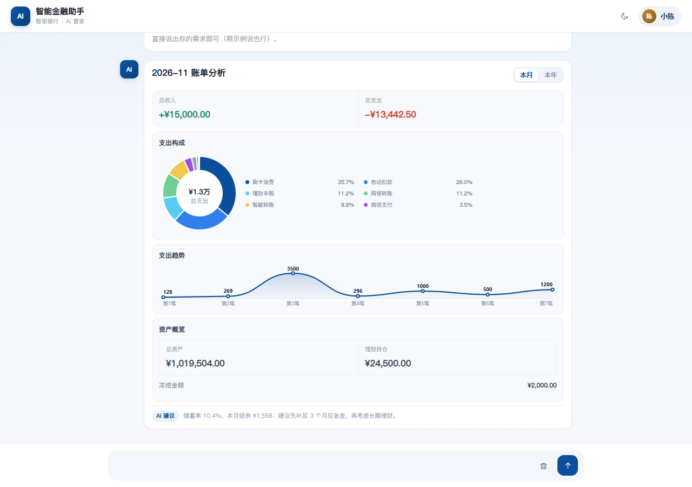
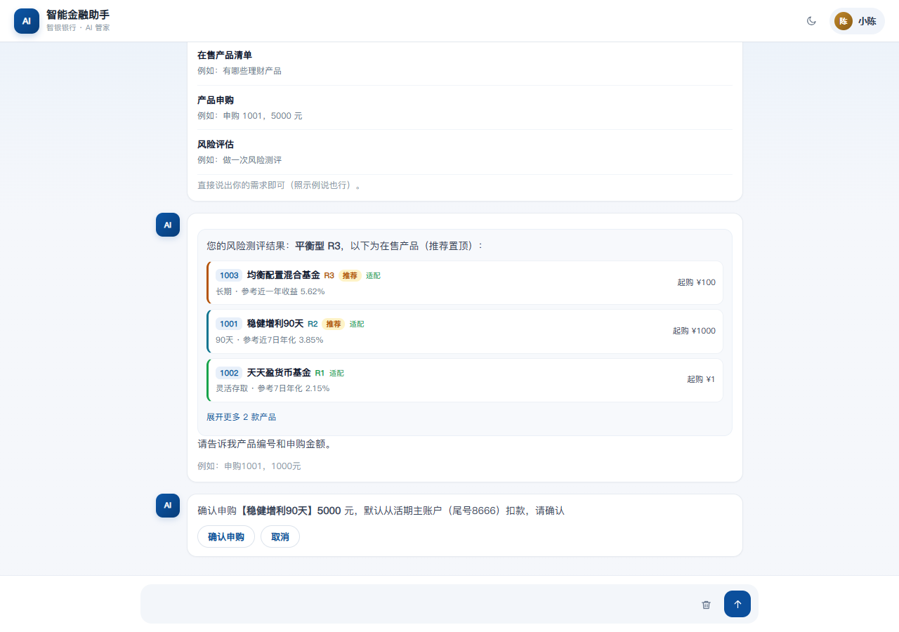

# 智银管家 · ZhiYin Banker Copilot

**代码仓库**：https://github.com/new-coder-new/AI-Bank

面向个人客户的**对话式银行智能服务台**（演示原型）：把转账、账单、卡片、理财、订阅、鲜花等业务，收敛成「一句话 + 确认卡 + 分级安全验证」。资金判定与审计由服务端权威处理，前端只负责呈现与引导。

- 本地入口：`http://127.0.0.1:8787/`
- 运行形态：单端口 Web 应用；仓库只保留 TypeScript，`npm run build:ts` 输出到 `build/js/`
- 运行时零第三方依赖：Node 内置模块 + SQLite

## 界面预览

| 桌面端首页 | 移动端首页 |
|---|---|
|  |  |

| 引导式转账确认 | 定时转账确认 |
|---|---|
|  |  |

| 账单分析 | 理财申购确认 |
|---|---|
|  |  |

## 功能清单

| 模块 | 能力 |
|---|---|
| 转账收款 | 姓名转账、手机号转账、定时转账、AA 收款 |
| 账单与交易 | 账单分析（本月 / 本年）、异常交易 |
| 卡片管理 | 我的卡片、卡片申请、额度调整、交易限制、卡片挂失 |
| 理财 | 我的持仓、在售产品、产品申购、风险评估 |
| 订阅管理 | 我的订阅、可订阅会员、添加订阅、自动续费、取消订阅 |
| 生活订购 | 生日鲜花（鲜花 + 蛋糕、订单查看） |
| 账户 | 账户总览、基本信息、卡片信息、复核审批、交易记录、联系人 |
| 平台能力 | 一键重置演示数据、深色模式、审计流水 |

## 快速开始

```bash
npm install
npm start            # 首次会编译 TS，然后启动服务
# 打开 http://127.0.0.1:8787/
```

| 命令 | 作用 |
|---|---|
| `npm start` | 编译并启动服务（端口 8787） |
| `npm run dev` | Vite 开发模式（HMR） |
| `npm run build` | 编译 38 个 TS + Vite 打包 |
| `npm run typecheck` | 三套 tsconfig 全量严格检查 |
| `npm test` | 10 个测试套件 |
| `npm run demo:record` | Playwright 自动录制演示视频 |

演示凭据：交易密码 / 短信验证码统一 `123456`；头像 →「重置演示数据」可恢复初始状态。

## 系统架构

| 层 | 实现 |
|---|---|
| 前端交互 | 38 个 TypeScript 模块（约 2.2 万行），经典脚本 + 全局类型声明，三套 tsconfig strict 通过 |
| HTTP 接口 | Node 内置模块，38 个 `/api` 路由，静态托管白名单 + 同源校验 |
| 领域能力 | 意图路由、槽位抽取、金额档位、风险识别、定时任务、复核、审计 |
| 数据 | SQLite（`node:sqlite`，WAL）：`state` 快照 + `ledger` 审计流水 |
| AI（可选） | 服务端代理 `/api/ai/chat`；未配置 Key 时自动降级为规则引擎 |

## 对话交互设计

```
主菜单 → 二级菜单 → 槽位补齐 → 确认卡 → 分级验证 → 结果卡 → 收尾问句
```

- 菜单只负责「进哪个模块」，业务信息用自然语言补齐（金额、时间、收款人、用途等）
- **确认卡是唯一执行入口**，未完成确认前拒绝新指令
- 每笔完成 / 取消后追问「还需要办理其他业务吗」
- 缺槽追问示例：「请问几点执行？」「请告诉我产品编号和申购金额」

## 安全分级 T1–T4

| 档位 | 金额 | 验证方式 | 资金动作 |
|---|---|---|---|
| T1 | < ¥1,000 | 交易密码 / 指纹 | 确认后执行 |
| T2 | ¥1,000 – 9,999 | 短信验证码 | 验证后执行 |
| T3 | ¥10,000 – 99,999 | 短信 + 人脸 | 验证后执行 |
| T4 | ≥ ¥100,000 | 短信 + 人脸 + 人工复核 | **不扣款**，审批通过后执行 |

- 最终档位 = max(金额档, 可疑度档)：高风险行为至少 T3，中风险至少 T2
- 服务端权威：金额档位、余额、产品价格、复核结论均由服务端计算
- 一次性验证令牌（`X-Bank-Verify`）：绑定操作，消费即失效，防重放
- 审计流水：所有资金动作写入 `ledger`，只追加不修改；`GET /api/ledger` 可查
- 复核来源：大额转账（≥¥10 万）、信用卡申请、额度调整

## API 概览（节选）

| 方法 | 路径 | 说明 |
|---|---|---|
| GET | `/api/snapshot` | 获取业务快照 |
| POST | `/api/transfer` | 转账（判档 + 令牌校验） |
| POST | `/api/verify/issue` | 签发验证令牌（演示 OTP 123456） |
| POST | `/api/card/apply` | 信用卡申请（进复核队列） |
| POST | `/api/wealth/buy` | 理财申购 |
| GET | `/api/ledger` | 审计流水 |
| POST | `/api/review/approve` / `reject` | 人工复核通过 / 拒绝 |
| POST | `/api/reset` | 重置演示数据 |

## 目录结构（节选）

```
index.html            页面骨架（引用 build/js 下编译产物）
css/style.css         全局样式（含手机断点）
js/core/              配置、接口、存储、UI 工具
js/flows/             各业务流程（转账、账单、卡片、理财、订阅…）
js/agent/             意图、知识库、风险识别与工具定义
server/index.js       HTTP 服务与 38 个 API
server/db.js          SQLite 持久化与演示数据播种
tests/                10 个测试套件
scripts/              构建插件、部署、自动演示、预览截图
docs/                 使用手册、测试用例、部署说明、安全审查报告
```

## 部署

| 方式 | 命令 / 说明 |
|---|---|
| 本地 | `npm install && npm start` |
| Docker | `docker build -t zhiyin . && docker run -p 8787:8787 -v $(pwd)/data:/app/data zhiyin` |
| 云服务器 | `bash scripts/deploy-cvm.sh` |
| 局域网手机演示 | `http://<电脑内网IP>:8787/`，需放行 8787 端口 |

详见 [docs/部署说明.md](docs/部署说明.md)。

## 演示与录制

```bash
node scripts/mobile-browser.mjs        # 手机尺寸浏览器窗口（390×664 设备模拟）
npm run demo:record                    # 自动录制：断言 6 大步骤并合成 mp4
npm run demo:record:android            # Pixel 7 设备模拟
```

- 自动录制成片约 4 分钟，输出到 `preview/demo/*.mp4`
- 手动演示脚本：[docs/演示脚本.md](docs/演示脚本.md)、全模块版 [docs/演示脚本-全模块.md](docs/演示脚本-全模块.md)

## 测试与质量

- 三套 tsconfig 全量 strict 检查，0 错误
- 10 个测试套件：意图、主菜单、模块守卫、目录、二级菜单、确认卡守卫、芯片枚举、服务端接口、源码守卫、LLM 意图样例
- 服务端接口测试使用临时端口与临时数据库，不污染演示数据
- 构建产物 hash 化，Docker 多阶段构建

## 已知边界

- 演示环境：PIN / OTP 固定 `123456`，仅用于演示，不适用于生产
- 仅支持单用户会话；无 HTTPS、无多租户鉴权
- 定时任务依赖页面打开补跑，未接入后台调度器
- SQLite 单机存储，适合演示量级

## 文档索引

| 文档 | 内容 |
|---|---|
| [docs/使用手册.md](docs/使用手册.md) | 功能与话术说明 |
| [docs/测试用例.md](docs/测试用例.md) | 意图、槽位、边界用例 |
| [docs/部署说明.md](docs/部署说明.md) | 本地 / Docker / CVM / 局域网 |
| [docs/安全审查报告.md](docs/安全审查报告.md) | 安全设计与变更记录 |
| [docs/演示脚本.md](docs/演示脚本.md) | 5 分钟演示分镜 |
| [docs/演示脚本-全模块.md](docs/演示脚本-全模块.md) | 全模块三集方案 |

## 许可

本项目为演示原型，仅用于学习、比赛与技术交流。
